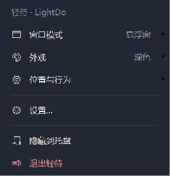
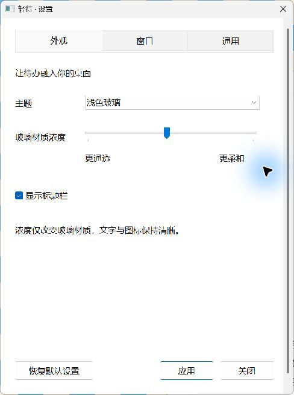
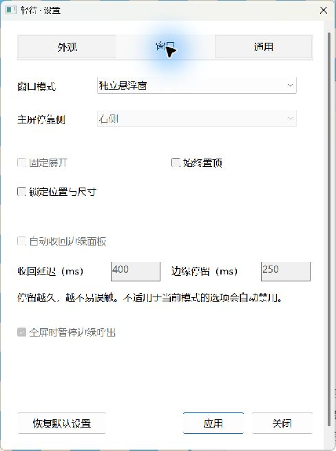

# 菜单与设置改版

## 入口归并

| Before | After | Why |
|---|---|---|
| 21 项平铺在一个长菜单 | 6 个主入口，模式、外观、位置与行为分组 | 常用操作更容易扫描，菜单不再接近屏幕高度 |
| 三种模式和左右停靠混排 | 「窗口模式」中统一选择 | 当前模式有勾选，非边缘模式的停靠选项禁用 |
| 浅色、深色、系统主题分散 | 「外观」中统一选择 | 主菜单直接显示当前主题 |
| 固定、置顶、锁定、自动隐藏混排 | 「位置与行为」归组 | 明确区分功能，按模式禁用不适用项 |
| 两条「更透明 / 更浓」及开机启动快捷项 | 设置中的单一连续滑块与启动开关 | 删除重复入口，保留更精确的调节方式 |
| 所有设置挤在同一页 | 「外观 / 窗口 / 通用」三个页签 | 相关选项集中，不增加待办功能 |
| 导入 QuietDo | 按用户确认的独立项目定位移除 | 不读取其他应用的数据，不保留导入逻辑 |
| 无分组边界的默认系统菜单 | 统一线性图标、38 DIP 行高、薄分隔线、圆角悬停色块 | 提升可读性和操作反馈，支持浅深色与系统高对比色 |

菜单由原生 TrackPopupMenu 管理，自绘只负责样式。菜单是清晰的不透明操作表面，没有将它宣传为带真实折射的玻璃块。原生编辑、应用设置和待办数据仍各自保留唯一状态。

## 运行证据与范围

以下是本机改版开发过程中实际运行的独立菜单和设置窗口，截图不含桌面私人内容。

已观察：浅深色菜单、主题切换、子菜单、悬浮模式下选项禁用、外观/窗口页切换、设置入口、F10 打开及 Esc 关闭菜单；中文和 Emoji 新增后清空输入且保留焦点、JSON 保存与首尾空白清理。

用户已对 71b5f56 构建手动验证新版桌面 Win+D 往返、添加/编辑与层级，反馈「一切正常！」；菜单 F10、方向键、Esc 和设置模式选择反馈「可以实现」。这些是用户实测反馈，已计入对应项目；没有扩大为睡眠、Explorer 重启和所有 DPI 场景通过。项目正式发布门槛仍为 pending。

补充修正：非边缘模式隐藏标题栏的「固定展开」按钮；设置中改变悬浮窗置顶立即应用，不需要切换模式；禁用项保留所属模式的偏好。当前标准 release 路径已重建并运行移除导入的新版本，浅深色主菜单截图已更新。已实际确认非边缘模式无固定展开按钮、无导入入口，设置置顶仍需专项复核。
