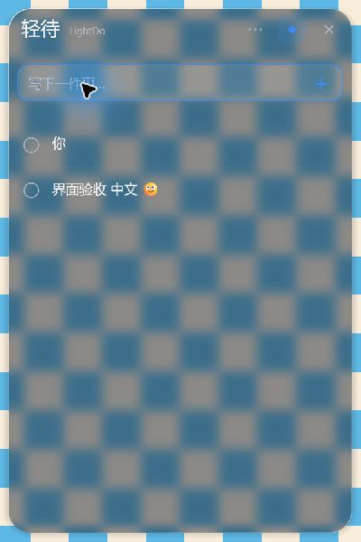
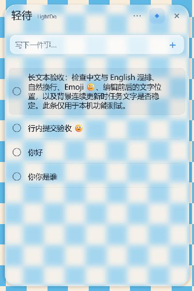
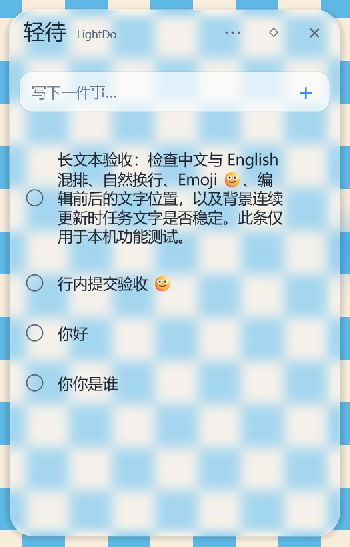
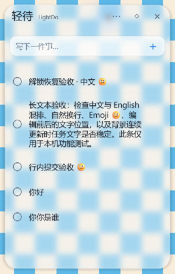
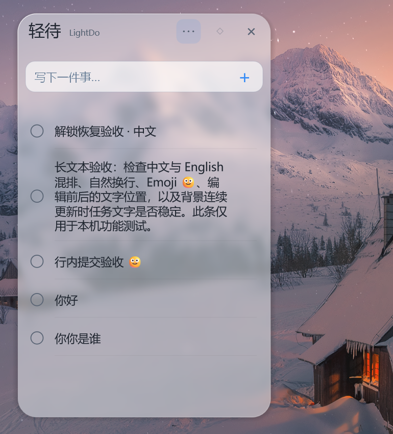

# 验收记录

状态：1.0.0 已由正式标签自动构建并公开发布，公开下载资产校验、D盘安装/重启及用户最终界面验收均通过。最终目录清理在实际执行后单独记录。以下仅把实际观察或用户手测的范围记为通过。

## 环境与数据

Windows 11 26H2 26300.9711 x64；i9-13900H、20 逻辑处理器、16 GB 内存，Intel UHD Graphics / RTX 4070 Laptop GPU；2560×1600 单显示器，当前 150%（窗口 DPI 144）。未据此宣称所有 Windows 11、DPI 或多屏场景均通过。

GitHub 登录 Richard-Nido / Yuan Haoran，用户确认使用其独立公开仓库 [Richard-Nido/LightDo](https://github.com/Richard-Nido/LightDo)。两个参考项目实际提交及 MIT 复用范围见 architecture.md。按用户后续要求，QuietDo 数据导入已完全移除；不再将导入列入验收。

当前安装在 `%LOCALAPPDATA%\Programs\LightDo`，版本 1.0.0，未签名。升级验收将隔离测试状态复制到 `%APPDATA%\LightDo\state.json`；解锁恢复测试后包含五条合成任务。不要把当前运行误记为 LIGHTDO_DATA_DIR 隔离进程。`--diagnose` 不输出任务正文或背景像素。

## 已取得的实际证据

| 项目 | 方法与结果 | 范围/限制 |
|---|---|---|
| 需求及源码阅读 | 完整需求、实际 QuietDo/Glance 源码与许可阅读 | 架构与采用 SHA 见 architecture.md |
| 真实玻璃 | 受控动态网格位于独立测试窗口，浅深色主面板显示真实模糊、圆角边缘位移；拖动后仍更新，无自身反馈 | 截图仅含合成任务；不是内置壁纸或预制 UI |
| 中文输入 | 150% 原生 EDIT 的拼音 n/i 候选、Space 选择“你”、Enter 新增并清空输入且保留焦点 | 100/125/200%候选定位的后续实测见DPI行；不等同于各档全部编辑回归 |
| IME Enter | 早期真实组合 Enter 仅确认候选，第二次 Enter 新增；行内组合与 Esc 观察 | 早期 images/p0-ime-inline.jpg 仅证明对应构建；不套用到全部新版本 |
| 编辑提交 | 用户手测 Enter 保存、Esc 取消、点击上方输入框失焦保存均正常 | 用户结果对应行布局调整之前；后续安装 1.0.0 又实际行内输入“行内提交验收 🙂”并 Enter 保存成功 |
| 任务与布局 | 新增长混合文本自然换行、完成删除线与撤销保持原位、JSON 保存；缩小窗口后正常重排 | 已将行文字/勾选/删除按行中心布局；原生编辑与展示共用宽度/基线并跳过重复定位。上述操作未再观察到抖动，不保证所有偶发情况已消失 |
| 标题与输入 | 三个标题图标按可见笔画居中；菱形置顶 true→false→true；40 DIP 输入与 14 DIP 单行空态、删除普通模式文字 | 浅深色实际检查；真实输入保留原生 IME |
| 菜单和设置 | 实际分组菜单、主题与禁用状态；用户手测 F10/方向键/Esc 和设置模式选择“可以实现” | 滑块、自启登记、冲突与恢复默认已在后续补充实测；注销启动未测 |
| 设置直达键 | 用户确认菜单与Ctrl+F10正常；独立设置窗口修正后自动化也实际打开 | 早期工具未列出窗口曾被误判为关闭，已纠正；完整设置交互见本页后续补充 |
| 桌面层 | 用户针对新版 71b5f56 手测 Win+D 往返、添加/编辑与普通应用层级“一切正常！” | 当前为顶层工具窗维护桌面 Z 序；废弃 SetParent 子窗口方案的旧结果不计入 |
| 缩放窗口 | 安装 1.0.0 实际从约 400×600 缩到 350×540 DIP，布局正常；后续高度约547 DIP | 自动工具禁止拖到当前窗口外，放大拖动未通过该工具验证 |
| 左右边缘 | 默认 Right；真实右侧停留、保持边缘条、离开隐藏及普通最大化背景通过；后续左侧实际展开位于[12,390,537,1210]且foreground=false | 左侧测试时临时关闭全屏避让，因背景为受控无边框全屏；测试后恢复Right/避让开启。快速掠过/跨屏仍未实测 |
| 实际DPI变化 | 系统设置150%→100%→125%→200%→150%，同一安装进程；每档右边缘呼出且背景就绪，窗口DPI依次96/120/192/144；100/125/200%实际原生拼音候选在输入框下方，Esc取消组合，四条任务保持 | 100%矩形[2198,526,2548,1073]；125%[2111,458,2548,1141]；200%[1848,253,2548,1347]；恢复150%[2023,390,2548,1210]。只证明本机单主屏和本轮操作，不等同于多屏或每档全部编辑交互 |
| 快捷键及 Esc | Ctrl+Alt+L 实际呼出并获取输入焦点；Esc 后鼠标仍在右边缘保持隐藏，离开再进可重开；同一 PID | 自定义键及冲突处理已按后续补充实测 |
| 呼出动画 | 临时在系统设置打开动画，真实运行观察连续滑入；诊断记录 left 从2568逐步到2023，Opening→Expanded，显示时背景就绪；随后恢复原“动画关闭”偏好 | 目标220 ms，平滑插值、可反向状态测试通过；诊断采样不等于60fps视频或完整反向手势验收 |
| 隐藏与占用 | 10 次展开/收回，同一进程保持；随后48.96秒右边缘隐藏，47个窗口样本全部隐藏，CPU0.0032%、GPU0%，共享GPU74.75 MiB | 捕获池休眠复用，当前非活动；完整指标与哈希见 performance.md。不是长期无泄漏的保证 |
| 升级保留数据 | 实际0.1.0→1.0.0按用户安装，任务与设置文件逐字节相同，payload哈希匹配，卸载登记版本正确 | test-upgrade.ps1，安装暂保留供GUI验收；主动删除和最终Release安装尚未完成 |
| 安装保护/文件级冒烟 | 运行中安装拒绝1618且不强杀；此前静默安装、同版本覆盖、默认卸载保留合成标记、开始菜单清理通过 | GUI页面、当前版本卸载主动删除、自启清理仍待 |
| 常规检查 | fmt、all-targets check，最新37项中28通过、9个真实桌面测试/实验明确忽略 | 含Windows短暂文件独占锁、明确Esc收回、可配置吸附边界与兼容回归；不把忽略测试记为通过 |
| 原生捕获专项 | 等待受控红窗脱离初始DWM cloak后，连续3轮每轮12/12首帧正确；连续读取5/5；排除WDA_EXCLUDEFROMCAPTURE且保持WDA_MONITOR保护语义 | 未采用丢首帧、DwmFlush或重建会话实验；场景日志不打印其他窗口标题 |
| 原生捕获压力 | 60.83秒、1192排列、198次rest、143帧、3841受控重绘，无卡死，最大排列46.1ms | 对应当时捕获构建，不等于当前全部GUI与长期泄漏通过 |
| CI | [40296556997](https://github.com/Richard-Nido/LightDo/actions/runs/40296556997)，cf8de57，成功 | 该提交检查/构建成功，不证明之后未提交改动或GUI已验收 |
| 右边缘修改CI | [40355360971](https://github.com/Richard-Nido/LightDo/actions/runs/40355360971)，ac2bbbb，成功 | 格式、检查、23项常规测试、构建和安装冒烟；实际GUI证据另列 |
| 发布保护 | 验收 pending 时发布脚本正确失败，不建标签 | 正式发布尚未执行 |
| 发布资产前置检查 | 六项当前版本资产通过；对测试副本篡改安装包或移走许可声明均被拒绝 | publish-release.ps1 -ValidateOnly，仅本地预检；草稿上传/重新下载逐文件SHA校验/公开发布尚未实际运行 |

## 已发现并保留的问题记录

- 捕获专项最初失败源自测试红窗仍被DWM cloak；修复夹具后通过，不能把原失败抹去。
- 旧桌面子窗口排除实验失败，生产方案已废弃该路径。
- 右边缘第8次截图曾显示短暂纯色面板，随后恢复。原动态测试背景本身也多次呈现纯色或部分网格：GDI直接逐块绘制暴露中间帧。测试背景现改为完整帧一次提交；新背景下已再次观察正确玻璃，仍需继续检查首帧及闪烁，不能据此直接宣称所有闪烁已消除。
- 捕获池反复销毁的旧构建曾记录共享GPU约310.87 MiB；休眠复用版本的1/4/10次样本约74/93/75 MiB，未出现单调增长。两个版本不是严格相同历史的配对实验，不虚报节省百分比。
- 未查询到本次测试附近的lightdo.exe崩溃/挂起事件；这不能保证永不闪退。
- 后续复测发现一次快捷键呼出后自动收回，PID仍在；激活时机从屏幕外预备阶段移到滑入至少一半之后。修正构建实际诊断foreground=true、Expanded并持续展开，用户随后确认设置入口/快捷键正常。不要把“自动收回”误记为进程崩溃。
- 原生菜单打开时开发命令--shutdown曾等待菜单结束；含EndMenu修正的cd858b3d构建已实际打开菜单后正常退出，约0.352秒，任务文件哈希不变。第一次检测错误地沿用了PowerShell旧LASTEXITCODE，随后改用Start-Process -Wait读取真实退出码复测；未把脚本误报当作产品失败或成功。
- 左侧面板实际遮挡独立设置窗口，已修正：设置保持独立顶层，同时跟随面板置顶层级并排在面板之前；切到Desktop时同步回普通层。实际重开、应用左侧设置后无遮挡，切Desktop后仍可操作。
- 快速标题拖动实际未离开边缘，查明队列消费时采样鼠标位置太晚，起点已接近终点。改为从鼠标按下消息转换屏幕坐标。修正安装版同一窗口实际拖出到[185,390,710,1210]、Floating/topmost=false，再拖回[12,390,537,1210]、Edge/topmost=true，五条任务保持。
- 当前安装1.0.0应用哈希为0751214fb061fb5f8599312f13f5a8a2d96fc8d7edcf547c489453b4cb1ae945；包括设置层级与拖动起点修正。performance.md的不同哈希测量保留各自范围。

## 已知限制与未受测条件

- 本机仅一个物理显示器，未实测主屏更换、外接屏断开；几何边界测试不能代替真实多屏硬件。100/125/150/200%的右边缘布局及候选定位已受测，但不声称每档全部交互组合已穷尽。
- 最低实际受测系统为本机Win11 26H2 build26300.9711，其他Windows11版本、独占全屏游戏、所有第三方桌面/录屏软件组合未验证。
- 自启开关和登记清理已测，未注销Windows验证实际登录启动。睡眠/Win+D/图标的用户手测不被包装为工具证明每次同一进程连续运行。
- 当前系统减少动画；先前临时启用动画观察连续滑入，反向状态有回归，未录制60fps完整反向手势视频。
- 已测只读保存失败、损坏读取及短暂共享锁；未实测磁盘耗尽和每种NTFS权限组合。短时模式/隐藏采样不等于全天无泄漏保证。
- 安装包及应用未签名；不声称消除SmartScreen，不要求关闭防护。

## 2026-10-27 设置与模式实测补充

- 已安装候选实际完成透明度 48→70 保存、深色玻璃、跟随系统及浅色/48 恢复；四条合成任务摘要保持不变。
- 已实际切换边缘/右侧、悬浮、置顶、固定展开、锁定。悬浮模式诊断为 Floating/topmost=false，置顶切换为 true；锁定后拖动和缩放矩形保持不变，之后恢复 Edge/Right。
- 已实际开启并关闭开机启动：HKCU Run 项指向已安装 EXE，关闭后登记项消失；尚未注销 Windows 验证启动。
- 临时占用 Ctrl+Alt+Shift+F8 时，设置明确提示冲突并保留 Ctrl+Alt+L；释放占用后新快捷键实际呼出面板，随后恢复默认快捷键。
- 已实际点击恢复默认并应用，读取为 Edge/Right/System/48/400×600/Ctrl+Alt+L/autostart=false，任务摘要未变化。
- 含设置窗口独立顶层修正的安装版已实际切换 Desktop；诊断为 Desktop/toolWindow=true，设置窗口仍能被桌面工具列出并操作，随后恢复 Edge/Right。

这些证据仍不等于注销后自启、Explorer 重启、锁屏/睡眠、主动删除数据和正式 Release 已通过。

2026-10-27后续：已在正常退出后保留全部任务、原子恢复测试前的Edge/Right/Light/48、350×547、Ctrl+Alt+L和自启关闭，任务摘要一致。之后Windows实际锁定（lockFlag=0/locked=true），暂停桌面输入并结束两个无数据测试背景；全屏避让用例尚未完成。当前EXE为627200字节、NotSigned；直接导入表未见VC运行库DLL。最终清理仅预览，已识别两项旧0.1.0生成文件，未删除。

清理专项新增隔离实测：test-clean-delivery.ps1在local-evidence下的新建合成Git仓库中，验证脏树拒绝、已跟踪目标拒绝、当前版本资产保留、旧版合成资产删除，以及源码/Git目录保留，均通过；实际项目未执行清理。该测试也发现并修正了Windows CRLF版本行识别问题。check.ps1现会检查所有PowerShell脚本语法并执行此隔离专项；Rust常规测试仍为23通过、9忽略。

## 2026-10-27 解锁与后续修复实测

- 用户回复“桌面已解锁”后，实际诊断locked=false。PID35024与锁屏前一致；Ctrl+Alt+L呼出后foreground=true、Expanded、backgroundReady=true，原生输入新增中文/Emoji测试任务并持久保存，任务数4→5。随后Esc正常收回。此项证明边缘模式恢复，不冒充Desktop睡眠恢复。
- 独立无边框全屏受控背景下，鼠标右边缘停留后仍EdgeHidden、captureActive=false；Ctrl+Alt+L可主动呼出并输入。普通最大化窗口的前期结果单独保留；未测试独占全屏游戏。
- 同一安装构建c3edc3d2的日常右边缘隐藏测量50.78秒，47次窗口检查均隐藏；CPU0.0046%、GPU0%，完整内存与哈希见performance.md。后来设置/拖动修复构建没有套用该测量。
- 两轮覆盖安装均在正常退出后执行，状态文件逐字节相同；新进程恢复全部五条合成任务。最新安装有效负载与dist/stage一致。
- 本轮修复后check.ps1通过：PowerShell语法、隔离清理专项、fmt/check、23项Rust测试；9项真实桌面实验仍明确忽略。候选安装器368722字节，仍非公开正式Release。

## 2026-10-27 用户睡眠反馈与任务重启保留

- 用户明确反馈“睡眠恢复，组件输入，桌面图标都正常”。记录为用户实际手测通过；等待期间进程发生过更换，不将它包装为工具证明同一进程跨睡眠保持。
- 用户同时报告退出重开后历史任务不可见。检查时原文件仍含5条未完成任务，正常退出前后SHA一致；旧安装版重新启动后实际又显示这5条。上一次不可见的确切触发原因尚未确认，不能宣称已精确定位为某一系统错误。
- 补强默认路径：通过Windows Known Folder确定用户资料目录，继续使用原有LightDo/state.json，未迁移、清空或合并任务。开发隔离覆盖必须为绝对路径；无法确定目录时停止启动，不退回工作目录创建空清单。读取遭短暂Windows共享锁时最多重试500ms；失败保留原文件、禁止覆盖，并以明确错误空态替换普通“写下第一件事”。
- 新设置按钮实际打开资源管理器中的AppData/Roaming/LightDo，唯一文件state.json可见。没有打开或上传任务正文。诊断新增已加载任务数、未完成数和可读标记，不输出正文或路径。
- 安装版SHA-256为24fdab846550463d90189f1471e20c3c359e7be6de5d2368cfe585e7cf55cf5b。test-restart.ps1实际完成3个独立进程（PID20416、35776、22844），从不同工作目录冷启动，均readable=true、tasks=5、unfinished=5，原状态文件SHA保持一致。第三次启动后再实际呼出，截图观察到全部5条任务和可用输入框；该私人验收截图未提交仓库。
- 重启脚本首次错误地把Windows GUI诊断EXE输出赋值后再解析，产生诊断子进程的关闭管道错误，未取得有效测量。改为直接管道解析并检查退出码后，上述3次测试通过。错误来自测试脚本，未把它计为主应用崩溃或任务丢失。
- 新增Windows独占文件锁实测单元用例：持有原文件180ms后释放，启动读取重试得到原任务，原字节保持；最新常规结果24通过、9忽略。尚未把该局部测试冒充所有文件权限/磁盘失败的GUI验收。
- 已通过实际设置恢复Right，保留5条任务、Light/48、350×547及Ctrl+Alt+L。正式Release及最终清理仍未完成。

## 多任务与键盘交互补充

使用独立LIGHTDO_DATA_DIR建立32条合成任务，正式AppData的5条任务及文件SHA保持不变。

- 实际滚动900可见中段任务。发现按Tab从输入框进入列表时，选中的第一条仍在屏幕外；修正KEY_NAV同时恢复顶部位置后，实际滚到底部再Tab，第一条回到可见位置且选中。
- 大幅滚动9000到达末尾27—32条，最后一条可见；滚动超过上限时在本帧同步修正行位置，避免只更新滚动量却绘制旧坐标。
- 实际Space完成和再次Space撤销，第一条ID及位置保持不变，完成状态true→false，清单仍32条。
- 原生输入框Ctrl+A完整高亮中文及Emoji，Ctrl+C、Ctrl+End、两次Ctrl+V后得到三段完全一致的合成文本，Enter新增并保存，隔离清单32→33，JSON正文与预期完全一致。
- 纯空白输入后Enter，清单保持33，所有任务正文非空；最后清空未提交草稿。
- 交互修正候选SHA-256为33fe9b4dc425180ec52f495594e355900114e6a746f129b69555c25f14d42fe6。用户明确授权后，实际Delete删除刚新增的合成任务，33→32，目标ID消失，剩余32个种子ID完全相同；正式AppData文件SHA未变。未扩大授权删除其他任务。
- 第一次Delete工具返回窗口不可用，任务数仍33；诊断发现面板先自动隐藏。查明列表键盘焦点未列入阻止自动隐藏条件。修正后实际鼠标在面板外、Tab选中列表，1.3秒后仍Expanded/foreground=true；不再仅靠鼠标留在面板里通过键盘测试。
- 实际Esc在鼠标留在面板内时曾被pointer逻辑反向打开。修正明确收回优先于“鼠标仍在内部”，离开后才重新允许边缘呼出；新增回归。最新安装版实际Esc后650ms为EdgeHidden、visible=false，鼠标仍在原面板内部坐标[2218,637]，5条任务保留。
- 最新已安装SHA-256为7b1b879a8bff6f2a89b8ebb048f667311b43d2a5807d0bc50c22643458c5126f，独立3次冷启动PID40356/19508/38136均读到5条未完成任务且文件SHA不变。启动至数据与输入控件就绪的观测约410/252/239ms，含200ms轮询及诊断子进程开销，不冒充首帧玻璃显示延迟。
- dev.ps1现在finally恢复之前的LIGHTDO_DATA_DIR，避免运行隔离开发后，同一终端后来启动正式应用仍继承测试目录；没有据此把用户之前的不可见原因归为已确诊。

## 资源管理器与本机安装卸载补充

- 用户按要求重启Windows资源管理器后反馈“自动恢复成功”。实际Explorer PID14816→18580，轻待保持同一PID38136，恢复为Floating/toolWindow=false/topmost=false、窗口可见、backgroundReady=true、readable=true、5条未完成任务。此为明确的可恢复悬浮降级，未谎称自动继续Desktop。
- 原有数据目录完整移动到同级独立保护目录并逐文件校验后，只用一条合成任务进行卸载。卸载向导数据页实际可见，“同时永久删除任务和设置”默认未勾选。用户授权本次卸载后，向导已结束；工具没有执行最终点击，随后文件/注册表检查确认应用、卸载登记、开始菜单和测试自启项均已删除，合成任务文件SHA不变，原始保护目录SHA不变。
- 重新安装向导欢迎页被列出，但激活时用户物理Esc停止桌面控制，立即停止。未把未完成的工具操作记为GUI安装通过。用户随后明确报告已人工安装至D:\LightDo；实际核验D盘已安装EXE为7b1b879a构建、版本1.0.0、登记路径及卸载路径正确，开始菜单入口存在。
- 已核查新安装数据只含原合成标记、无新增用户任务。恢复原始保护文件逐字节一致，随后只把mode/side改回Edge/Right，所有任务ID、正文、完成状态保持相同。合成标记的运行后JSON被保留为本机临时证据；原保护目录已还原，不遗留第二份长期历史。
- D盘实际安装版再次完整退出/冷启动3次PID14436/23260/9420，均读到5条未完成任务，完整任务与设置内容、此次基线文件SHA均一致。观测数据及输入控件就绪约311/243/235ms，仍含轮询开销。
- 恢复后的首次测试曾因PowerShell与Rust的JSON空白格式不同，脚本把字节变化误判为数据变化。脚本现要求完整解析后的任务与设置内容不变，另报告字节SHA是否一致；没有放宽正文、ID、状态或设置的比较。格式规范化后再运行上述3次验证，字节也保持一致。
- 用户要求后续尽量避免Computer Use，已改为命令行/文件/真实进程诊断优先，必须视觉或交互的剩余项交给用户简短人工验收。主动删除数据选项与最终Release下载安装仍待，不能用默认保留卸载结果代替。

## 主动删除卸载与恢复（本机人工操作）

- 用户确认D盘恢复安装后的“任务可见／菜单保持正常”，包括三点菜单打开后鼠标移开不会收回。
- 再次正常退出，将正式数据完整移到同级独立保护目录，逐文件SHA校验；只在原LightDo目录放一条主动删除合成标记，未把真实任务交给删除测试。
- 第一次用户反馈忘记勾选；实际数据目录仍在，未记主动删除通过，仅保留为默认保留的重复结果。自动重装到同一D盘位置后，重新请用户操作。
- 第二次用户明确反馈“已勾选并卸载”。实际原合成LightDo目录不存在，D盘应用EXE不存在，卸载登记不存在；保护原数据SHA全部一致，主动删除用例通过。
- 随后静默重装当前同一候选至D:\LightDo，EXE哈希与dist/stage一致。原始保护目录整体还原，逐文件与保护SHA完全一致，不合并测试任务、不保留第二份长期任务历史。
- 恢复后独立冷启动3次PID1320/38612/33944，均读到5条未完成任务、完整任务和设置内容及文件SHA不变。当前默认Right/Edge，Light48、350×547、Ctrl+Alt+L、自启关闭。
- 本机静默安装、0.1→1.0升级、运行中拒绝安装、默认保留卸载、自启及快捷方式清理、用户人工D盘GUI安装、主动删除卸载已有实测；最终公开Release下载安装必须发布后另做，不提前计入。

## 人工边缘手势与真实错误提示

- 用户按清单补测快速掠过应不展开、停留呼出、离开后快速返回保持可用，重复约3轮，反馈“边缘手势正常”。未将减少动画下的结果称为完整滑动视频或所有跨屏场景通过。
- 在独立LIGHTDO_DATA_DIR运行合成清单，不移动或改写正式5条任务。第一次共享文件锁测试等待超过180秒后锁自动释放，用户正常新增且无提示；该轮判为无效故障注入，不把它记为失败提示通过。
- 改为仅把隔离state.json设为只读，用户再次新增后明确反馈出现保存失败提示。实际文件仍2条、SHA完全不变；内存4条（用户多次尝试），临时文件0，正式AppData SHA不变。解除只读后正常退出，原有2条ID保持，全部4条内存任务成功保存，验证重试恢复。
- 独立损坏JSON用例启动后diagnostic readable=false；用户确认读取失败提示、输入框禁写和原文件保留说明正常。正常退出前后损坏字节SHA不变，正式5条任务未改变。
- 测试后已退出隔离实例，正常启动D盘正式应用PID15340，readable=true、5条未完成，Edge/Right，正式任务文件SHA与测试前完全相同。没有遗留文件锁或只读属性。

## 最终模式往返与视觉交付

按清单使用菜单完成Edge→Floating→Desktop约3轮，并最后回桌面，用户反馈“一切正常”并提供当前真实截图。实际诊断为同一PID15340、Desktop、背景就绪、readable=true、5条未完成；仅过滤该进程的只读EnumWindows计数为1个LightDo.Panel、1个LightDo.Controller，没有第二个待办窗口。3个GlanceScene是本机背景合成窗口，不是待办副本。

预热Edge到最终Desktop的单点资源：工作集111.21→113.02MiB、私有89.92→91.07MiB、句柄502→506、线程13→7。仅证明本次短时使用历史下的两个点，不称单调趋势、严格配对优化或长期无泄漏。

用户图仅裁去无关桌面区域，未重绘界面、替换背景或增添特效。已有边缘与悬浮实际图，最终桌面图如下。截图证明对应构建/本机场景，桌面Z序行为另由Win+D等手测及诊断证明。

## 新增可配置拖动停靠范围

用户在正式标签前要求缩小悬浮拖到边缘时的判定范围，并能在设置中调节。默认48DIP→16DIP，窗口页“拖动停靠范围”接受4–96，Desktop模式禁用；预览、松手与系统移动结束路径共用同一DPI换算及最近边缘判定。

- 新增边界回归覆盖100/125/150/200%、主屏负坐标、左右恰好阈值/超1像素、自定义距离及范围重叠时选择近侧；旧JSON缺字段默认16、自定义保存及不丢任务通过。
- 最新37项中28通过、9真实桌面实验忽略；格式、all-targets检查和安装包生成通过。
- 已实际覆盖安装D:\LightDo，最新SHA8d47bccfe1f868e1308fe38ea66ade985f3594a5b1a4e463e4223a25b3b4345d。安装前后旧状态文件逐字节相同，启动后原有5条任务和既有偏好保持。缺省新字段在读取时补16，未保存前磁盘仍可无该字段，不能把null误报成距离0。
- 用户按要求确认默认16、修改8并应用、拖近边缘才预览且松手正常停靠、重新打开设置仍8，反馈“全部正常，已保留8”。本机读回snap_distance=8；新安装版3次冷启动PID36296/38400/24016，均5条未完成，完整任务/设置内容和文件SHA不变，值8保持。保留用户选择8，不擅自恢复默认16。
- [CI40446715246](https://github.com/Richard-Nido/LightDo/actions/runs/40446715246)对应f11eec8通过检查、28项常规测试、构建、打包及静默安装冒烟。窗口标记据本次结果恢复true，正式发布仍须提交源码指纹及标签工作流。
- 上方用户桌面图及7b1b879a的资源/故障实测属于新增距离之前的构建，保留各自范围；不套用为新哈希的直接测量。

## 正式标签、公开下载和最终安装

- 正式`v1.0.0`指向`c2c476d9f1d2bfdca00f71faf33af19a0705b1b6`，验收源码指纹`41947b11ee69a15e51d359b9f51bdd79f02980128545d0a97f1e8249a9b2955d`。[标签Actions40447543051](https://github.com/Richard-Nido/LightDo/actions/runs/40447543051)的build/publish均成功：版本/指纹、28项常规测试、安装构建与冒烟通过，草稿下载逐项校验后公开。
- [正式Release](https://github.com/Richard-Nido/LightDo/releases/tag/v1.0.0)实际`draft=false`、`prerelease=false`，2026-10-27T04:05:28Z发布。6项资产实际下载，安装包/许可ZIP匹配SHA256SUMS，全部6项又与GitHubAPI提供的sha256摘要逐一相符。机器可读结果见[release-validation.json](release-validation.json)。
- 最终下载EXE371488字节，SHA-256`831e093c8d9f57dc26385bacdba25ea8a1b751035af9540abb62674be127a576`。实际正常退出候选后，用该下载文件覆盖安装D:\LightDo，退出码0，安装器不改变准备好的数据字节，原5条任务完整保留。
- 最终安装应用版本1.0.0，SHA-256`9a83383752ac6c4019c3e2bf9c4ab9b48601cf6ea36fd9fc69367de023aca8a2`，发布者Yuan Haoran (Richard-Nido)，NotSigned。与本机候选8d47bccf哈希不同，不拿候选运行冒充公开二进制；最终公开版3次冷启动PID30508/11920/34980，完整任务和设置、状态文件SHA保持。
- 用户对这份真正公开下载版确认“正式版正常！”：玻璃和原任务可见、实际中文输入法新增、设置值8保持。当前6条未完成，原5个任务ID均保留；新增的任务只留在用户本机，不公开正文。安装准备时恢复Right，后续用户手动拖到Left，保留当前实际停靠状态；源码默认仍Right、默认吸附16，用户自定义值8保留。
- 最终公开应用直接导入表只见系统DLL，未见独立VCRUNTIME/MSVCP；开始菜单指向D盘应用，已安装许可/第三方声明/依赖清单与公开资产哈希一致。这不扩大为所有Windows/驱动环境兼容保证。
